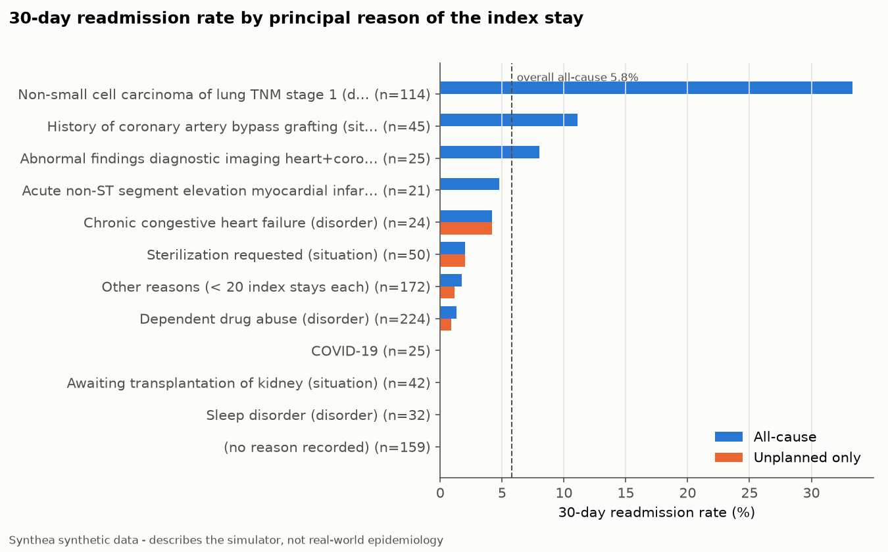
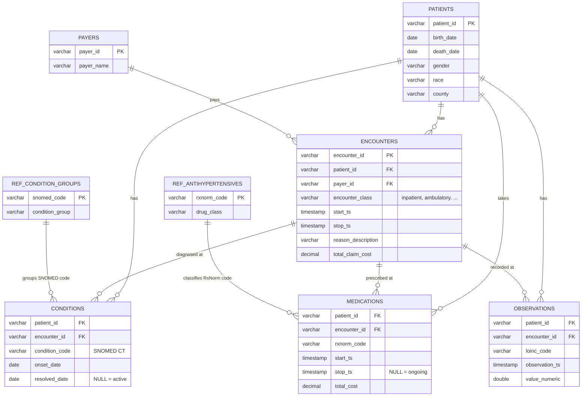
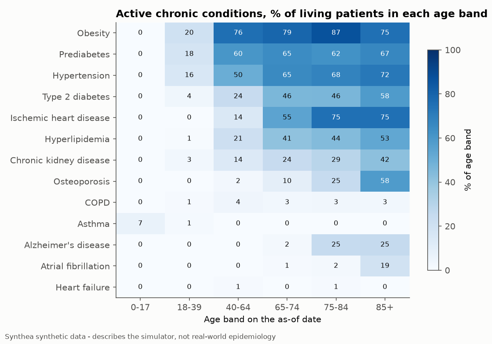
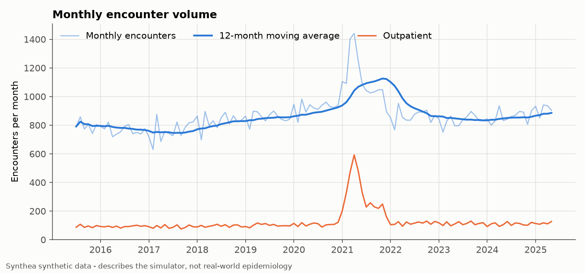
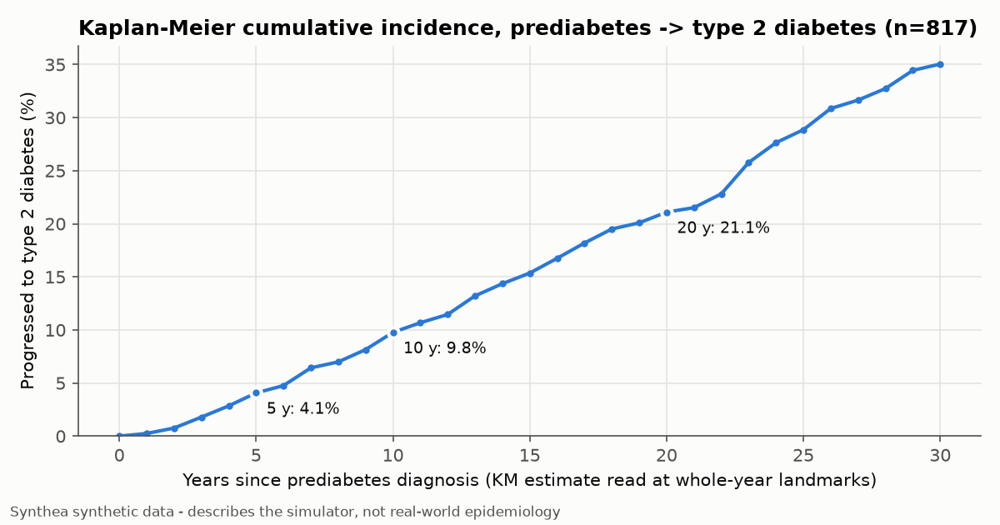

# Healthcare SQL Analytics on Synthetic EHR Data

[](https://github.com/lukahere007/healthcare-sql-analytics/actions/workflows/ci.yml)


[](LICENSE)

Ten clinical and operational questions a hospital analytics team gets asked (readmissions, length of stay, cost drivers, polypharmacy, care gaps, treatment pathways, disease progression), each answered with **one commented SQL file** over electronic health records for **2,337 synthetic patients** generated with [Synthea](https://github.com/synthetichealth/synthea).

> **The data is synthetic.** Synthea simulates patients from published clinical guidelines and statistics, so the numbers below describe *the simulator's clinical modules*, not real-world epidemiology. They are not evidence about any real population. The SQL is the point: definitions, edge cases, tests and data-quality checks.

## Headline answers

All numbers come from `python -m ehr_sql.run` on the committed extract (as-of date 2025-06-30, encounter window 2015-07-01 to 2025-06-30).

| Question | Answer |
|---|---|
| 30-day readmission rate | **5.8%** all-cause (54 of 933 index stays); **0.6%** unplanned. Lung-cancer treatment cycles cause 38 of the 54 readmissions, and they come from just 5 patients. |
| Length of stay | median **2 days**, mean 4.1, p90 10. COVID-19 stays are the longest (median 12 days). |
| Biggest cost driver | Prenatal care ("Normal pregnancy" ambulatory visits) makes up **23%** of all cost. The #2 driver is **11 alteplase records costing $44M**, a Synthea pricing artefact that the data-quality checks flag. |
| Polypharmacy, 65+ | **71%** had ≥ 5 drugs on board at the same time in the last 12 months; 23% had ≥ 10. |
| HbA1c care gap | **28%** of adult diabetics (73 of 260) had no HbA1c test in 12 months. 44% of the latest results that do exist are **below 4%**, which is physiologically implausible. |
| Hypertension first line | CCB **32%**, ACE inhibitor **31%**, thiazide **18%**, combination therapy **17%**. All are started on the day of diagnosis. |
| Prediabetes → type 2 diabetes | Kaplan-Meier cumulative incidence: **4.1%** at 5 years, **9.8%** at 10, **21.1%** at 20 (n = 817). |



## What this project demonstrates

| SQL skill | Where |
|---|---|
| Layered model: raw → typed staging → shared intermediate definitions → questions | [`00_load`](sql/00_load.sql), [`01_staging`](sql/01_staging.sql), [`02_intermediate`](sql/02_intermediate.sql) |
| **Gaps-and-islands** (running `MAX` + running `SUM` of a new-island flag) | merging transfer encounters into hospital stays, and refills into medication episodes ([`02_intermediate`](sql/02_intermediate.sql)) |
| Window functions: `LEAD`/`LAG`, `ROW_NUMBER`, `DENSE_RANK`, `RANK`, running totals, moving averages with explicit `ROWS` frames | Q3, Q5, Q6, Q8, Q9, Q10 |
| `QUALIFY` | latest HbA1c per patient (Q7), top-15 cost drivers (Q5) |
| Anti-joins with `NOT EXISTS` (NULL-safe) | care gap (Q7), orphan-key checks |
| Conditional aggregation (`COUNT(*) FILTER`, pivots) | prevalence by age band (Q2), monthly volume by setting (Q9) |
| `GROUPING SETS` / `GROUPING()` subtotals | Q1, Q3, Q4, Q6, Q7 |
| Date arithmetic: exact age, person-time overlap, 30-day windows, calendar spine via `GENERATE_SERIES` | macros in `01_staging`, Q5, Q9 |
| Sweep-line concurrency (+1/−1 events, running sum) | polypharmacy (Q6) |
| Kaplan-Meier product-limit estimator in pure SQL, `ASOF JOIN` | Q10 |
| Data-quality checks written as SQL and run as tests | [`sql/checks/`](sql/checks) |
| Hand-built fixture with a known answer for the readmission logic | [`tests/test_fixture_known_answers.py`](tests/test_fixture_known_answers.py) |

## Data model

The analysis uses five Synthea tables plus three hand-curated reference tables. Keys are UUIDs. Every raw column is stored as text and typed in [`01_staging.sql`](sql/01_staging.sql).



Derived views in [`02_intermediate.sql`](sql/02_intermediate.sql):
`int_patients` (age and vital status on the as-of date), `int_patient_conditions` (one row per patient × condition group), `int_inpatient_stays` (inpatient encounters merged into stays), and `int_medication_episodes` (refills merged into continuous exposure).

## The questions

Each file opens with the question, the definitions it uses and the techniques it shows. Results are in [`results/`](results).

### 1. Who is in the population? ([`01_demographics.sql`](sql/questions/01_demographics.sql))
2,000 living patients on the as-of date (52% female, median age 37); 15% are 65 or older. Synthea also keeps 337 deceased patients, who are excluded here and counted elsewhere.

### 2. How common are chronic conditions by age? ([`02_chronic_prevalence_by_age.sql`](sql/questions/02_chronic_prevalence_by_age.sql))
Among living patients: obesity 43%, prediabetes 34%, hypertension 31%, type 2 diabetes 16%. Hypertension rises from 16% (18–39) to 72% (85+).



### 3. What is the 30-day readmission rate? ([`03_readmission_30d.sql`](sql/questions/03_readmission_30d.sql))
**Definitions.** Overlapping inpatient encounters (transfers) are merged into one *stay* first, so a transfer is never counted as a readmission.

An **index stay** must meet all three conditions:
- discharged inside the window and at least 30 days before the as-of date;
- the patient is aged 18 or older;
- the patient is discharged alive.

A **readmission** is the patient's next stay, starting after the discharge and within 30 days of it. It is **unplanned** unless its principal reason is in the hand-curated [planned-admission list](data/reference/planned_admission_reasons.csv): chemotherapy, transplant and elective procedures, modelled on the CMS Planned Readmission Algorithm.

**Result.** 5.8% all-cause, 0.6% unplanned. Without the planned/unplanned split, the headline would mostly measure Synthea's lung-cancer treatment schedule.

### 4. How long do patients stay? ([`04_length_of_stay.sql`](sql/questions/04_length_of_stay.sql))
1,068 stays: median 2 days, p75 5, p90 10, max 32. 20% of stays last 7 days or more. COVID-19 (median 12) and drug detox (median 5) dominate bed-days.

### 5. What drives cost? ([`05_cost_drivers.sql`](sql/questions/05_cost_drivers.sql))
$16,100 per patient-year overall. The top 15 drivers account for 77% of cost, led by prenatal visits (23%). Alteplase comes second (14%) from only 11 records: each one is priced at about $4M, which is a simulator pricing quirk. In real work this would be the first thing to raise with the data owner.

### 6. How common is polypharmacy in older adults? ([`06_polypharmacy_elderly.sql`](sql/questions/06_polypharmacy_elderly.sql))
Among 305 living patients aged 65+, the median peak is 6 concurrent drugs. 71% reach ≥ 5 at some point in the last 12 months, rising from 60% (65–74) to 89% (85+).

### 7. Which diabetics are missing HbA1c monitoring? ([`07_care_gap_hba1c.sql`](sql/questions/07_care_gap_hba1c.sql))
28% of adults aged 18–75 with active type 2 diabetes had no HbA1c in the 12 months up to the as-of date. The median latest HbA1c among those tested is 4.0%, and 44% of latest results are below 4%. In a real patient that would be close to impossible: Synthea's diabetes module overshoots after treatment. This is why the query reports a plausibility column next to the "poor control" rate.

### 8. What is first-line treatment for new hypertension? ([`08_hypertension_first_line.sql`](sql/questions/08_hypertension_first_line.sql))
162 incident cases. The first-line choices are:
- calcium channel blocker: 32%
- ACE inhibitor: 31%
- thiazide: 18%
- two-drug combinations: 17%

Every patient starts treatment on the day of diagnosis, and 45% later add a drug from another class. `DENSE_RANK` (not `ROW_NUMBER`) keeps combination starts intact.

### 9. How has encounter volume changed? ([`09_monthly_encounter_trends.sql`](sql/questions/09_monthly_encounter_trends.sql))
Volume is stable at roughly 750–900 encounters a month, with one spike in early 2021, when outpatient visits jump to about 590 a month. That is Synthea's COVID-19 vaccination module.



### 10. How fast does prediabetes progress to diabetes? ([`10_prediabetes_to_diabetes_km.sql`](sql/questions/10_prediabetes_to_diabetes_km.sql))
A naive "% who progressed" ignores how long each patient was followed. Kaplan-Meier with censoring at death or the as-of date gives 4.1% at 5 years, 9.8% at 10 years and 35% at 30 years.



## Data quality

The checks live in [`sql/checks/`](sql/checks). Each one returns the rows that break a rule, so an empty result means a pass. `pytest` runs them, and the runner writes [`results/data_quality.csv`](results/data_quality.csv) and a per-column null-rate profile, [`results/data_profile.csv`](results/data_profile.csv).

- **Errors (must pass):**
  - unique, non-null primary keys;
  - no orphan foreign keys;
  - required fields parse to their types (`TRY_CAST` turns format drift into a NULL that the checks catch);
  - consistent dates: no encounter before birth, no clinical encounter after death, no overlapping stays after merging.
- **Warnings (reported, then handled):**
  - 97 prescriptions stop before they start; they are dropped from medication episodes;
  - 9,674 HbA1c values are below 4%;
  - 16 medication records cost over $1M each;
  - 312 "Death Certification" visits are dated after death. They are administrative, so they are excluded from the clinical rule.

## Reproduce

```bash
git clone https://github.com/lukahere007/healthcare-sql-analytics.git
cd healthcare-sql-analytics
python -m venv .venv && source .venv/bin/activate   # Windows: .venv\Scripts\activate
pip install -r requirements.txt

pytest                         # data-quality checks, query sanity tests, fixture tests
python -m ehr_sql.run          # runs every query -> results/*.csv and figures/*.png
python -m ehr_sql.run --db ehr.duckdb && duckdb ehr.duckdb   # optional: explore interactively
```

The committed extract is in `data/raw/` (Parquet, ~14 MB). To regenerate it from scratch (needs Java 17+):

```bash
bash scripts/generate_synthea.sh
```

That script pins everything that affects the output. It downloads Synthea **v3.3.0** (SHA-256 checked) and runs:

```
java -jar synthea-v3.3.0.jar -s 42 -cs 42 -p 2000 -r 20250630 -e 20250630 \
  --exporter.baseDirectory ./output --exporter.csv.export true \
  --exporter.csv.included_files patients.csv,encounters.csv,conditions.csv,medications.csv,observations.csv,organizations.csv,payers.csv \
  --exporter.fhir.export false --exporter.hospital.fhir.export false --exporter.practitioner.fhir.export false \
  Massachusetts
```

The committed snapshot was generated this way by the [`Generate Synthea data`](.github/workflows/fetch-data.yml) GitHub Actions workflow. [`scripts/convert_to_parquet.py`](scripts/convert_to_parquet.py) then keeps only the tables and observation codes used here, drops direct-identifier columns (synthetic, but not needed), and writes [`data/raw/MANIFEST.json`](data/raw/MANIFEST.json) with the command and row counts.

## Project structure

```
├── sql/
│   ├── 00_load.sql              # raw tables from Parquet + reference CSVs
│   ├── 01_staging.sql           # params, macros, typed stg_* views
│   ├── 02_intermediate.sql      # int_* shared definitions (stays, episodes, ...)
│   ├── questions/01..10_*.sql   # one question per file
│   └── checks/dq_*.sql          # data-quality checks
├── src/ehr_sql/                 # thin Python runner (build DB, run files, figures)
├── tests/                       # pytest: checks, query sanity, hand-built fixtures
├── data/raw/                    # Synthea extract (Parquet) + MANIFEST.json
├── data/reference/              # hand-curated code lists (with notes column)
├── scripts/                     # Synthea generation + Parquet conversion
├── results/  figures/           # outputs of python -m ehr_sql.run
└── .github/workflows/           # CI + data generation
```

## Limitations

- **Synthetic data.** Synthea's modules are simplified: every hypertensive is treated on day one, treated diabetics reach implausibly low HbA1c, and drug prices can be extreme. Treat the numbers as outputs of a simulator.
- **Small population.** There are 2,000 living patients and about 930 index stays. Rates for individual admission reasons rest on 20–200 stays, and the lung-cancer readmissions come from 5 patients.
- **Ten-year encounter window.** Synthea exports detailed encounters for roughly the last 10 years only (`exporter.years_of_history = 10`), so encounter-based metrics use 2015-07 to 2025-06. Conditions keep their full history, which is why Q10 can follow patients for 30 years.
- **Simplified clinical definitions.** The readmission measure borrows the CMS logic (index-stay exclusions, planned readmissions) but is not the CMS measure: there is no risk adjustment, and the planned list is hand-curated from the reasons that appear in this extract. HbA1c and age criteria follow HEDIS loosely.
- **Medication cost timing.** Each prescription's cost is attributed to its start date.
- **DuckDB dialect.** `QUALIFY`, `ASOF JOIN`, `COLUMNS(*)` and macros are DuckDB-specific (`QUALIFY` also works in Snowflake, BigQuery and Databricks). On Postgres or SQL Server, replace `QUALIFY` with a subquery on the window function, and `FILTER` with `SUM(CASE ...)`.

## Data source and citation

Synthetic patients generated with **Synthea™** (Apache-2.0), © The MITRE Corporation:

> Jason Walonoski, Mark Kramer, Joseph Nichols, Andre Quina, Chris Moesel, Dylan Hall, Carlton Duffett, Kudakwashe Dube, Thomas Gallagher, Scott McLachlan. *Synthea: An approach, method, and software mechanism for generating synthetic patients and the synthetic electronic health care record.* JAMIA 25(3), 2018, 230–238. https://doi.org/10.1093/jamia/ocx079

Code lists in `data/reference/` were hand-curated from the SNOMED CT and RxNorm descriptions present in this extract. Each has a `notes` column.

## License

[MIT](LICENSE) © Luke Wamalwa
